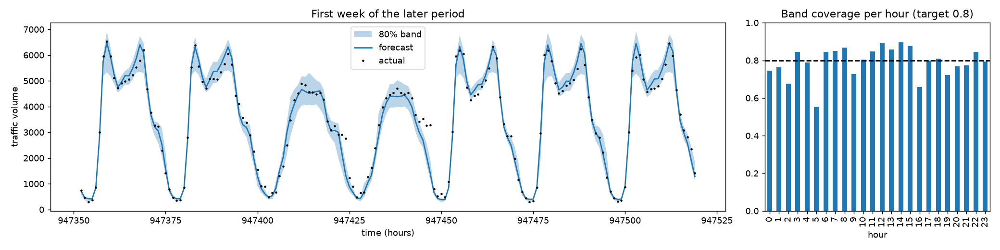
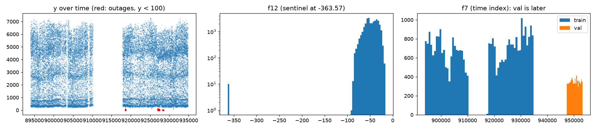
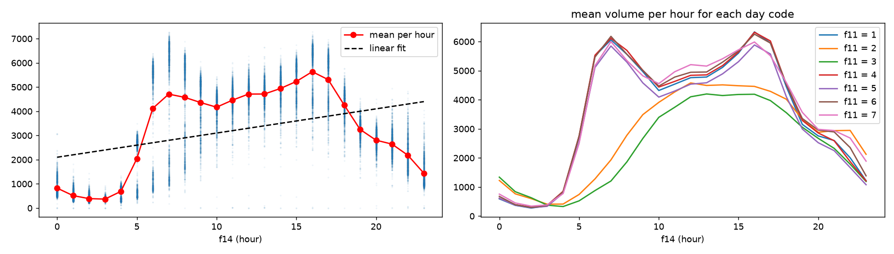
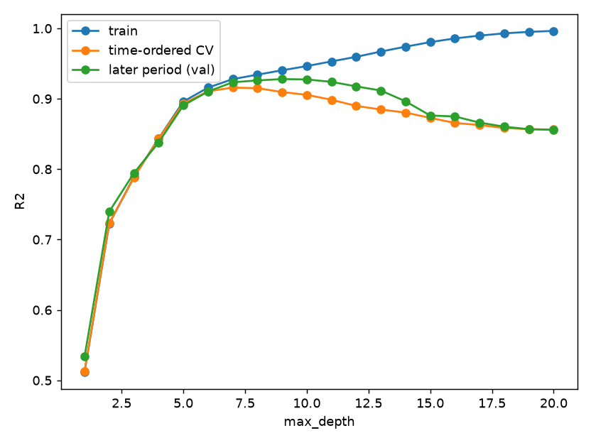
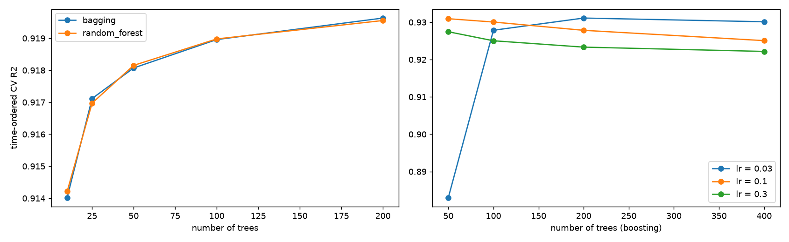
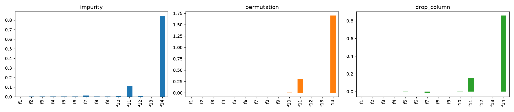

# Forecasting road traffic volume with trees, bagging and boosting

Predict the hourly traffic volume on a road, and its traffic level (4 classes), for a **later period** than any data used for training.
The data is uncleaned and anonymised (columns `f1`–`f14`). Most of the gain came from finding what was broken or leaking in the data, not from model tuning.

| model | R² on the later period |
|---|---|
| Linear regression | 0.157 |
| Single decision tree (depth 7) | 0.924 |
| **HistGradientBoosting + cleaning + holiday feature** | **0.952** (MAE 268 vehicles) |

The traffic-level classifier reaches a macro-F1 of **0.873** on the same later period.
Every volume forecast also comes with an **80% prediction band**, and 79.1% of the actual later-period volumes fall inside it.

## 📈 Forecast with uncertainty
A single number hides how sure the model is. Two extra HistGradientBoosting models are trained with the quantile (pinball) loss, for the 10th and 90th percentiles.
Together they give an 80% band around every forecast.

| on the later period | value |
|---|---|
| actual volumes inside the 80% band | **79.1%** (target 80%) |
| mean band width | 868 vehicles |

The band was never fitted on the later period, yet its coverage lands within one point of the target, so the uncertainty is well calibrated.
It is narrow at night (~120 vehicles at 3:00) and wide at rush hour (~1650 at 7:00), where traffic is harder to predict.
Coverage is weakest at 5:00 (55%), when the morning ramp-up starts, and at 16:00 (66%), the evening peak. Those hours vary most from day to day.



## Key findings

**1. Random K-fold is misleading for forecasting.** Here is the same model scored three ways:

| features | random 5-fold | time-ordered 5-fold | later period |
|---|---|---|---|
| all columns | 0.960 | 0.884 | 0.875 |
| without f2, f3, f7, f8 | 0.947 | 0.931 | 0.935 |

Random folds let the model interpolate between neighbouring hours, so they reward columns that identify *when* a row is.
Sorting by time and always testing on the next block (`TimeSeriesSplit`) matches the real use case.
After the cleanup it lands within 0.005 of the true later-period score. All model selection uses it.

**2. Data problems found in the EDA**

| problem | evidence | fix |
|---|---|---|
| impossible values | f5 max 6849 (next largest 38.8); f12 = −363.57 repeated in 10 rows | set to NaN |
| sensor outages | 60 rows with volume < 100, many at busy hours (lowest normal night volume is 123) | drop from training |
| time index | f7 counts hours (f7 mod 24 = hour); later period is fully outside its range | drop as a feature, use for ordering |
| row id / noise / period code | f8 unique per row; f2 has correlation −0.001; f3 codes in the later period never appear in training | drop |
| holiday flag only at midnight | f13 > 0 only at hour 0 | spread to the whole day (`hol_day`) |

Missing values (f6 4.9%, f12 8.8%) carry little signal. Native NaN handling and median imputation score the same.



**3. Why linear fails.** Volume follows a daily profile with morning and evening peaks. The profile changes with the day code f11: two of its codes have much lower traffic and behave like a weekend. A straight line in "hour" cannot follow it, while a tree can split it into regimes.



**4. Bias vs variance in practice**



| model (time-ordered CV / later period) | R² |
|---|---|
| decision tree | 0.916 / 0.924 |
| bagging | 0.919 / 0.926 |
| random forest | 0.928 / 0.933 |
| gradient boosting | 0.922 / 0.934 |
| HistGradientBoosting | 0.928 / 0.935 |

Bagging and random forests reduce **variance**: averaging more trees helps, then plateaus.
Boosting reduces **bias**, but with a high learning rate it starts overfitting after fewer trees.



**5. Impurity importance hides a harmful column.** f7, the time index, gets positive impurity importance and zero permutation importance.
Only drop-column importance shows the harm: removing f7 *improves* later-period R² by 0.015.
High-cardinality columns give trees many split points to fit noise, so impurity importance overrates them.



**6. Ablation**

| step | time-ordered CV | later period |
|---|---|---|
| raw columns | 0.885 | 0.872 |
| + drop f2, f3, f7, f8 | 0.931 | 0.936 |
| + impossible values → NaN | 0.931 | 0.936 |
| + drop outage rows | 0.935 | 0.936 |
| **+ holiday-day flag** | **0.949** | **0.952** |

**7. Decision tree vs SVM on the traffic level (macro-F1, later period)**

| features | decision tree | RBF SVM |
|---|---|---|
| raw | 0.853 | 0.601 |
| cleaned | 0.876 | 0.768 |

The SVM was already standardised, so scale was not the problem.
It lost because integer category codes produce meaningless distances, irrelevant columns still count in the distance, and time columns move outside the training range.
A tree splits one feature at a time and ignores all three.

## Run it

```bash
pip install -r requirements.txt
python src/experiments.py --data data    # all figures + results/metrics.json (~5 min)
python src/train.py --data data          # final models + 80% band, scores on the later period
```

Expected data layout (not included in this repo):

```
data/
  partB_reg_train.csv  partB_reg_val.csv   # f1..f14, y = traffic volume
  partB_clf_train.csv  partB_clf_val.csv   # same rows, y = traffic level 0–3
```

## Project structure

```
src/features.py      cleaning, feature engineering, time-ordered CV
src/models.py        seeded model factory, final hyperparameters, quantile models
src/experiments.py   EDA, validation comparison, depth curve, ensembles, importance, ablation, tree vs SVM, forecast band
src/train.py         train the final regressor (with 80% band) and classifier
results/             figures and metrics.json
```

Built with pandas and scikit-learn.
